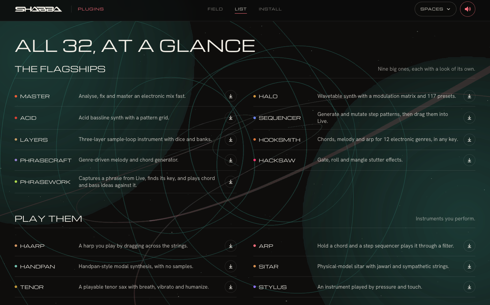
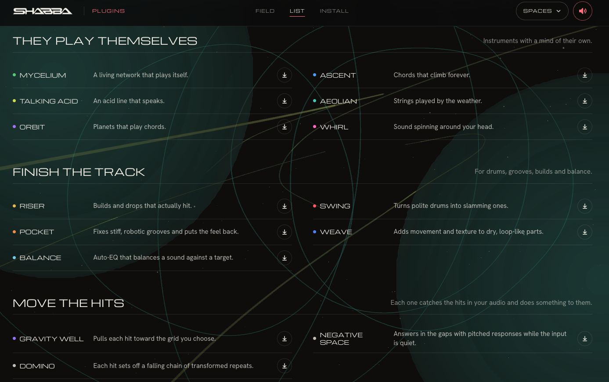
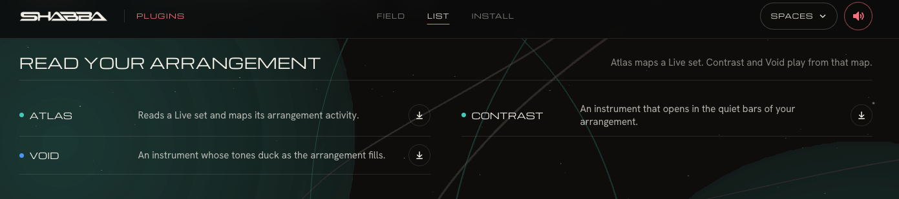

# SHABBA Plugins

You know the sound you want. Now find the instrument or effect that gets you closer. SHABBA Plugins is a set of 32 free VST3 plugins for macOS on Apple silicon (M1 or newer).

- [Browse the plugin catalog](https://plugins.shabbamusic.com)
- [Download the latest release](https://github.com/Shabbamusic/shabba-plugins/releases/latest)
- [SHABBA Music on YouTube](https://www.youtube.com/@ShabbaSounds)

## Plugin catalog

Pick one plugin, put it on a track, and change a control while the music plays. Small experiments are a good way to find a sound of your own. Browse the collection on the [SHABBA Plugins site](https://plugins.shabbamusic.com).

## Your first experiment

Choose an instrument or effect from the catalog, install it in a VST3-compatible host, and try changing one control. Compare the sound before and after so you can hear what the plugin adds.

## Install

1. Download the plugin ZIP you want from [Releases](https://github.com/Shabbamusic/shabba-plugins/releases/latest) and unzip it.
2. Move the .vst3 bundle into Macintosh HD > Library > Audio > Plug-Ins > VST3, or the same folder inside your Home folder.
3. The plugins are not notarized by Apple, so macOS may block them at first. Open Terminal and remove the quarantine flag for the installed plugin, replacing the example name as needed. Example: xattr -dr com.apple.quarantine "/Library/Audio/Plug-Ins/VST3/SHABBA Halo.vst3"
4. In Ableton Live, go to Preferences > Plug-ins, enable Use VST3 Plug-In System Folders, then rescan. The plugins appear under Plug-ins > SHABBA.

Each ZIP also contains these steps in INSTALL.txt. Requires a Mac with Apple silicon and a VST3-compatible host. Ableton Live 11 or 12 is documented as supported.

## Downloads and integrity

GitHub shows SHA-256 digests beside the release assets. Compare the displayed digest with your downloaded file if you need to verify it.

## Help and updates

For product information, visit [plugins.shabbamusic.com](https://plugins.shabbamusic.com). Report reproducible problems in [GitHub Issues](https://github.com/Shabbamusic/shabba-plugins/issues) and include the plugin name, macOS version, host, and steps to reproduce.

Explore [Ref2Set](https://github.com/Shabbamusic/ref2set), [ARCLINE](https://github.com/Shabbamusic/arcline), [Visualizer](https://github.com/Shabbamusic/shabba-visualizer), [Audio](https://audio.shabbamusic.com), and the [SHABBA hub](https://shabbamusic.com).

## License and source availability

This repository provides release downloads and installation instructions; it does not include the plugin source code or state a software license. Confirm redistribution terms for the plugins and any third-party components before redistributing them or describing them as open source.
